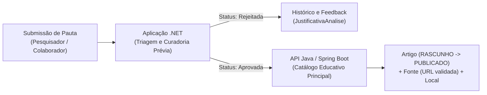

## Descrição do projeto

Lumar - Plataforma educativa sobre tecnologia nuclear - Solução final do projeto completo

API/Aplicação em .NET voltada à triagem e curadoria prévia de propostas de conteúdo científico sobre tecnologia nuclear, atuando como porta de entrada editorial para a plataforma educativa AMAZUL.

A aplicação gerencia o ciclo de vida das propostas de conteúdo por meio da entidade `PropostaConteudo`, registrando o tema sugerido, a fonte de referência original e o parecer técnico do curador:

### Modelo de Domínio (`PropostaConteudo`)

| Propriedade | Tipo | Descrição |
|---|---|---|
| `Id` | `int` | Identificador único da proposta submetida. |
| `Titulo` | `string` | Título sugerido para a pauta (ex.: *"Produção de Tecnécio-99m no Reator Multipropósito Brasileiro"*). |
| `Area` | `AreaAplicacao` | Eixo temático da aplicação nuclear (`Energia`, `Saude`, `Agricultura`, `Industria`, `Pesquisa`). |
| `Url` | `string` | Endereço da fonte primária ou artigo científico que embasa a proposta. |
| `StatusAnalise` | `Status` | Estado atual na fila de curadoria (`EmAnalise`, `Aprovada`, `Rejeitada`). |
| `JustificativaAnalise` | `string` | Parecer técnico do avaliador explicando os motivos da aprovação ou rejeição da fonte. |
| `DataCriacao` | `DateTime` | Data e hora de registro da submissão. |

## Objetivo do projeto

O principal desafio de comunicação pública no setor nuclear é o desconhecimento e o estigma sobre o uso pacífico dessa tecnologia. No entanto, por tratar de temas sensíveis, como medicina nuclear, segurança radiológica, propulsão naval e geração de energia, a plataforma educativa não pode publicar conteúdos sem verificação prévia de veracidade e rigor científico.

O objetivo desta aplicação em **.NET** é fornecer um **fluxo estruturado de submissão, triagem e avaliação prévia (`PropostaConteudo`)**. Ela permite que pesquisadores, colaboradores e divulgadores científicos sugiram pautas anexando links de referências primárias (relatórios da AIEA, normas da CNEN, estudos do IPEN ou publicações do CTMSP/AMAZUL) antes que esses materiais sejam redigidos e publicados como artigos definitivos na base principal.

## Escopo da Sprint 1 (.NET)

Nesta **Sprint 1**, foi desenvolvida uma **Prova de Conceito (PoC) em Aplicação Console .NET** que implementa o módulo de **Triagem e Curadoria Prévia de Propostas de Conteúdo (`PropostaConteudo`)**. O escopo contempla:
- Modelagem da entidade de domínio `PropostaConteudo` e dos enumeradores `AreaAplicacao` e `Status`, com validações de integridade encapsuladas (`ValidarCadastro` e `ValidarJustificativa`);
- Regras de negócio para o ciclo de vida editorial (submissão inicial em análise, aprovação e rejeição exigindo parecer técnico mínimo de 10 caracteres e bloqueio de transições inválidas de status);
- Operações interativas via console para cadastro, listagem geral, busca por ID e filtragem com LINQ (por status `EmAnalise` e por `AreaAplicacao`);
- Tratamento de exceções com blocos `try/catch` garantindo resiliência na interação via terminal;
- Persistência de dados em arquivo JSON (`propostas.json`) utilizando `System.Text.Json`, com resolução automática do caminho do arquivo tanto via CLI (`dotnet run`) quanto via IDE (Visual Studio / Rider).

## Como a aplicação em .NET se aplica à solução Java

A solução completa do Challenge AMAZUL divide responsabilidades entre dois serviços complementares que compartilham a mesma taxonomia de áreas (`Energia`, `Saude`, `Agricultura`, `Industria`, `Pesquisa`):



### 1. Filtro de Qualidade e Rastreabilidade (.NET)

Como indicado na documentação da API Java, a simples mudança de status de um artigo para `PUBLICADO` não realiza revisão científica automática. A aplicação .NET resolve essa lacuna funcionando como etapa anterior (pré-publicação): nenhuma pauta vira artigo sem antes ter sua `Url` e relevância aprovadas em `PropostaConteudo`.

### 2. Alinhamento Direto de Domínio com a API Java

Quando uma `PropostaConteudo` recebe o status `Aprovada` no .NET, seus dados alimentam diretamente as estruturas da API Java:

- O `Titulo` e a `Area` (`AreaAplicacao`) dão origem ao cadastro inicial do Artigo (em estado `RASCUNHO`) na API Spring Boot (`/api/artigos`), onde serão detalhados o resumo, a aplicação real no cotidiano (`aplicacaoReal`) e o impacto na sociedade (`impactoSociedade`).

- A `Url` validada na proposta e a `JustificativaAnalise` servem de base para o cadastro da Fonte bibliográfica (`/api/fontes`) e seu respectivo vínculo com o artigo (`/api/artigos/{id}/fontes`).

### 3. Separação de Responsabilidades

Enquanto a aplicação .NET foca no fluxo editorial de entrada, auditoria de propostas e justificativas de avaliação, a API Java concentra-se na divulgação pública do acervo validado, no relacionamento N:M entre artigos e fontes e no mapeamento geográfico de instalações nucleares (`Local` / integração com países).

## Arquitetura

A aplicação segue uma divisão modular de responsabilidades:

- **`Models/` (`PropostaConteudo.cs`)**: Camada de domínio contendo a entidade principal `PropostaConteudo`, os enumeradores `Status` (`EmAnalise`, `Aprovada`, `Rejeitada`) e `AreaAplicacao` (`Energia`, `Saude`, `Agricultura`, `Industria`, `Pesquisa`), além das validações de invariantes de domínio (`ValidarCadastro` e `ValidarJustificativa`).
- **`Services/` (`PropostaService.cs`)**: Camada de regras de negócio e persistência. Gerencia o cadastro, consultas filtradas com LINQ (`Where`, `FirstOrDefault`, `Max`), transições de aprovação/rejeição e leitura/gravação no arquivo JSON via `System.Text.Json`.
- **`Menu/` (`MenuConsole.cs`)**: Camada de interface em linha de comando (CLI) responsável pela exibição do menu interativo, leitura segura e validação de entradas numéricas do usuário.
- **`Program.cs`**: Ponto de entrada (`Main`) que orquestra o loop de execução da aplicação Console e centraliza o tratamento de erros com `try/catch`.
- **`propostas.json`**: Arquivo de persistência local em formato JSON que mantém o estado das propostas cadastradas e avaliadas entre diferentes execuções do sistema (pré-populado com propostas reais sobre tecnologia nuclear).

## Funcionalidades

- Cadastro de propostas com validação de título, área temática e URL da fonte científica
- Listagem de todas as propostas cadastradas
- Listagem de propostas pendentes (`EmAnalise`)
- Busca e filtragem de propostas por área de aplicação (`Energia`, `Saude`, `Agricultura`, `Industria`, `Pesquisa`)
- Busca e exibição detalhada de uma proposta específica por `Id`
- Aprovação e Rejeição de propostas com validação de status e registro de justificativa técnica

## Tecnologias Utilizadas

- .NET 10 (`net10.0`)
- C#
- `System.Text.Json` (Persistência JSON)
- LINQ (Consultas e filtros em memória)

## Grupo e Integrantes

**Grupo:** Lumar — Challenge AMAZUL (2TDS)

| Integrante | RM |
|---|---|
| Paulo Cavalcante Caroba | 566667 |
| Renan da Silva Paulino | 566610 |
| Sérgio Henrique S. Santos | 567254 |

## Instruções para execução do projeto

### Opção 1 — Via Terminal (CLI)

1. Clone o repositório e acesse a pasta do projeto Console:
```bash
cd Amazul.Analise.Console
```

2. Restaure os pacotes, compile e execute a aplicação:
```bash
dotnet restore
dotnet build
dotnet run
```

*(Alternativa a partir da raiz do repositório):*
```bash
dotnet run --project Amazul.Analise.Console/Amazul.Console.csproj
```

### Opção 2 — Via IDE (Visual Studio 2022+ ou JetBrains Rider)

1. Abra o arquivo de solução `backend-dotnet.slnx` (ou `Amazul.Analise.Console/Amazul.Console.csproj`).
2. Pressione **F5** (ou clique em **Run**). A aplicação localizará automaticamente o arquivo `Amazul.Analise.Console/propostas.json` com os registros iniciais.
